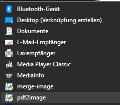

# pdf-image-tools

Two small Windows tools for the Explorer right-click menu:

- **pdf2image**: converts every page of one or more PDFs into PNG images (300 DPI).
- **merge-image**: joins several images into one, stacked vertically or side by side.

No console window, no background process, nothing is overwritten.

*Deutsch: siehe unten.*

## Requirements
- Windows 10 or 11
- Python 3 from [python.org](https://www.python.org/) (includes the `py` launcher)

## Install
Download the repository, unpack it to a permanent folder and double-click `setup.bat`.
It installs [PyMuPDF](https://pymupdf.readthedocs.io/) and [Pillow](https://python-pillow.org/) for your user and adds both tools to **Send to**.

## Usage
- **pdf2image**: select PDFs (or a folder) > right-click > *Send to* > *pdf2image*.
  Result: a folder `<PDF name>_bilder` next to each PDF with `seite_1.png`, `seite_2.png`, ...
- **merge-image**: select images (or a folder) > right-click > *Send to* > *merge-image*, then choose *Yes* = vertical, *No* = side by side.
  Order follows the file names naturally (`page_2` before `page_10`). Result: `zusammen.png` in the same folder.
- Double-clicking a `.pyw` file opens a file picker instead.

Settings such as DPI or image format are at the top of `pdf2image.pyw`.

## Uninstall
Run `uninstall.bat` (removes the *Send to* entries), then delete the folder.

## Notes
The user interface is currently in German. Translations and pull requests are welcome.

## License
MIT, see [LICENSE](LICENSE).

---

# pdf-image-tools (Deutsch)

Zwei kleine Windows-Werkzeuge für das Rechtsklick-Menü:

- **pdf2image**: wandelt jede Seite einer oder mehrerer PDFs in PNG-Bilder um (300 DPI).
- **merge-image**: fügt mehrere Bilder zu einem zusammen, untereinander oder nebeneinander.

Kein Konsolenfenster, kein Hintergrundprozess, nichts wird überschrieben.

## Voraussetzungen
Windows 10 oder 11 und Python 3 von python.org.

## Einrichten
Repository herunterladen, in einen festen Ordner entpacken, `setup.bat` doppelklicken.

## Bedienung
- **pdf2image**: PDFs (oder Ordner) markieren > Rechtsklick > *Senden an* > *pdf2image*. Ergebnis: Ordner `<PDF-Name>_bilder` neben jeder PDF.
- **merge-image**: Bilder markieren > Rechtsklick > *Senden an* > *merge-image*, dann *Ja* = untereinander, *Nein* = nebeneinander. Ergebnis: `zusammen.png` im selben Ordner.
- Doppelklick auf eine `.pyw`-Datei öffnet stattdessen eine Dateiauswahl.

## Entfernen
`uninstall.bat` ausführen, danach den Ordner löschen.

## Lizenz
MIT, siehe [LICENSE](LICENSE).
